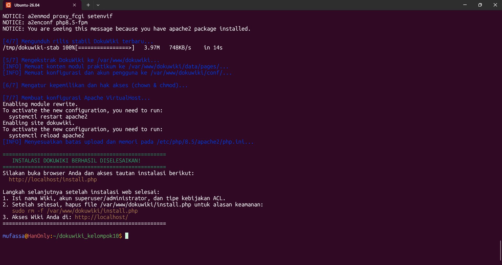
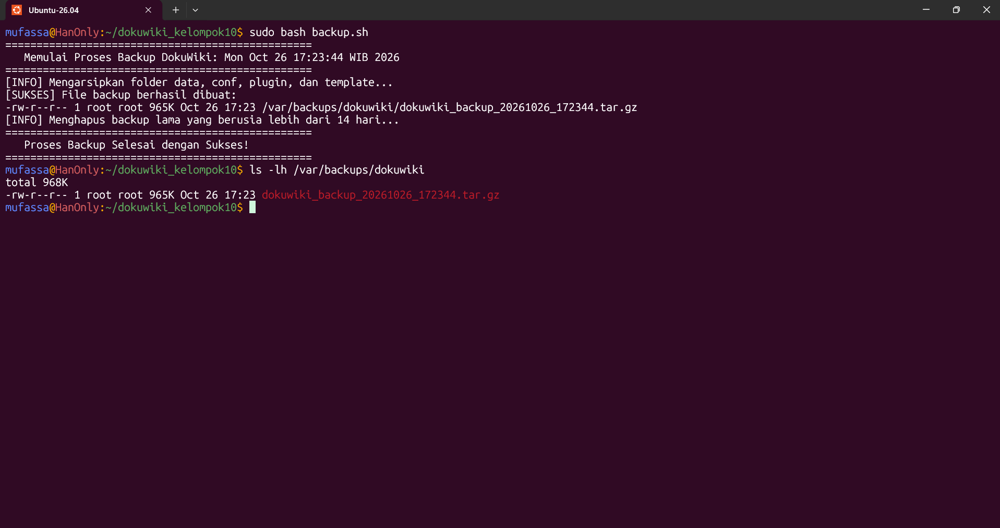
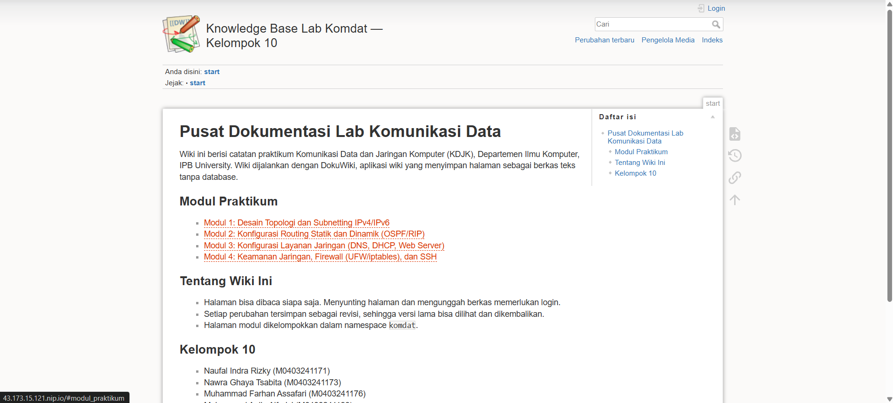
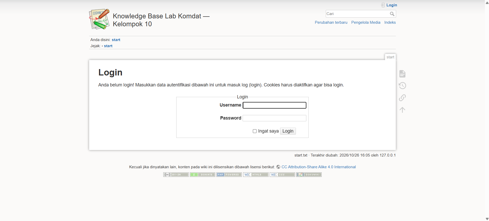
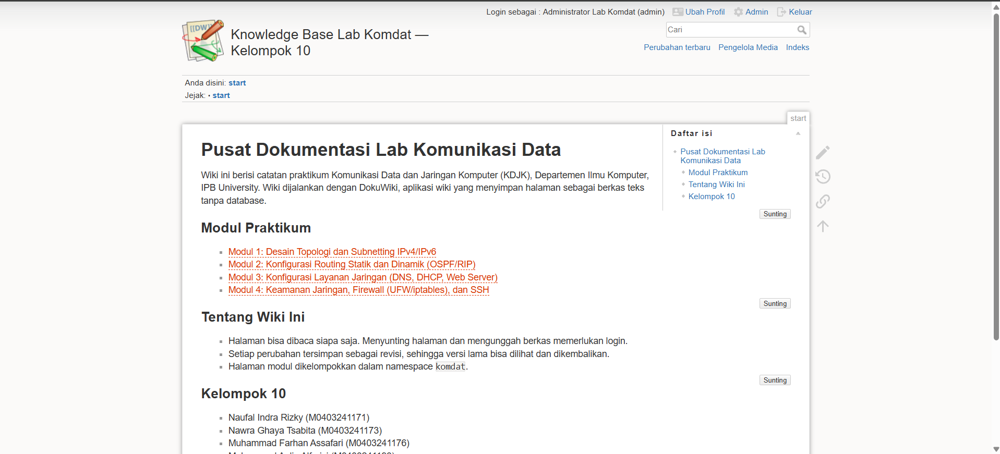
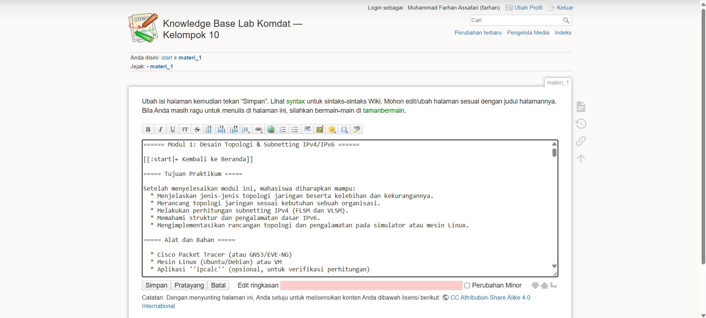
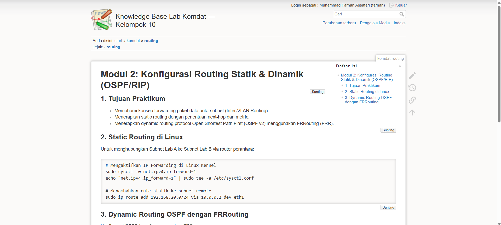
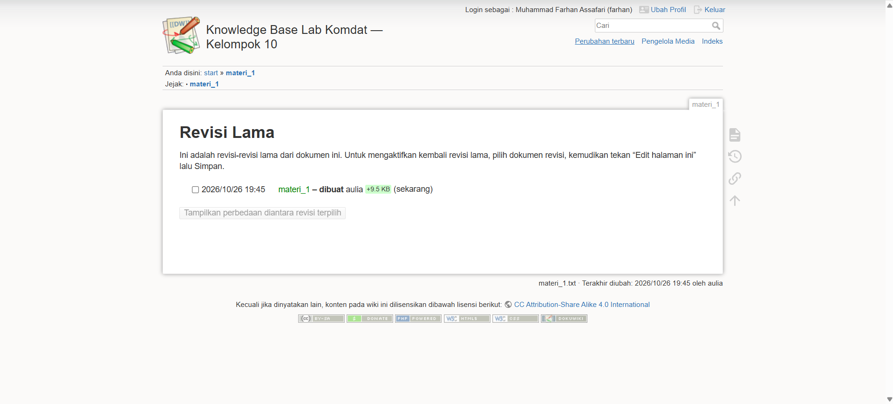
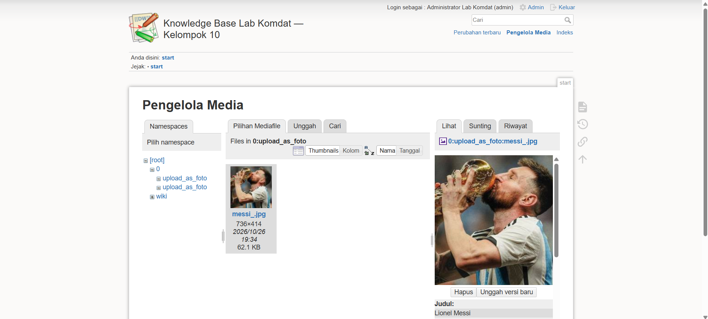
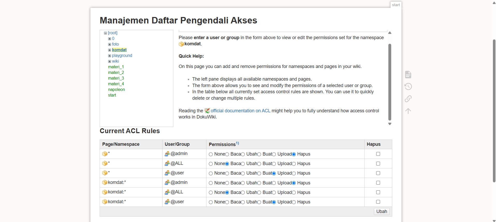

# Aplikasi Web DokuWiki

Tugas Proyek Aplikasi Web Self-Hosted — Praktikum Komunikasi Data dan Jaringan Komputer (KDJK)  
Departemen Ilmu Komputer, IPB University

### Kelompok 10
- Naufal Indra Rizky (M0403241171)
- Nawra Ghaya Tsabita (M0403241173)
- Muhammad Farhan Assafari (M0403241176)
- Muhammad Aulia Alfarisi (M0403241193)

---

## 1. Sekilas Tentang

DokuWiki adalah aplikasi wiki open source berbasis PHP yang ditujukan untuk keperluan dokumentasi teknis, catatan tim, dan pembuatan basis pengetahuan (knowledge base).

Ciri khas utama DokuWiki dibandingkan kebanyakan sistem manajemen konten (CMS) lainnya adalah DokuWiki tidak membutuhkan database relasional SQL (seperti MySQL atau PostgreSQL). Seluruh halaman, riwayat revisi, dan metadata disimpan dalam bentuk berkas teks biasa (flat-file) di dalam sistem direktori server.

Karakteristik dan kelebihan DokuWiki:
- Hemat sumber daya: Penggunaan memori RAM sangat rendah (kurang dari 64 MB), sehingga sangat cocok dijalankan pada VM atau server berspesifikasi terbatas.
- Kemudahan pemeliharaan dan backup: Karena tidak memakai database terpisah, pencadangan data semudah menyalin direktori berkas.
- Kontrol versi bawaan: Setiap kali dokumen diperbarui, versi sebelumnya tetap tersimpan dan dapat dibandingkan perubahannya (diff) serta dikembalikan (rollback).
- Kontrol akses (ACL): Memiliki pengaturan izin berjenjang untuk membatasi siapa yang boleh membaca, mengedit, mengunggah file, atau mengelola sistem.

---

## 2. Instalasi

### Prasyarat Sistem
- Sistem Operasi: Linux (Ubuntu Server 22.04 / 24.04 LTS) atau container Docker di Dokploy
- Web Server: Apache 2.4 atau Nginx
- Bahasa Pemrograman: PHP versi 8.0 ke atas
- Ekstensi PHP: `php-xml`, `php-mbstring`, `php-gd`, `php-zip`, `php-curl`, `php-intl`
- Basis Data: Tidak memerlukan database SQL

### Cara 1: Instalasi Menggunakan Docker Compose (Dokploy)
Repositori ini menyediakan berkas `docker-compose.yml` untuk mempermudah proses deployment:

1. Clone repositori ke server atau hubungkan ke Dokploy:
   ```bash
   git clone https://github.com/NaufalIndraR/dokuwiki_kelompok10.git
   cd dokuwiki_kelompok10
   ```

2. Jalankan service menggunakan Docker Compose:
   ```bash
   docker compose up -d
   ```

3. Buka peramban dan akses alamat server:
   ```text
   http://<IP-SERVER>:8080/install.php
   ```

4. Lengkapi formulir setup awal (nama wiki, akun admin, serta kebijakan ACL), lalu simpan.

---

### Cara 2: Instalasi Manual CLI di Ubuntu Server (Native Apache2)

Langkah-langkah instalasi manual pada sistem operasi Ubuntu Server:

1. Perbarui repositori sistem:
   ```bash
   sudo apt update && sudo apt upgrade -y
   ```

2. Install web server Apache2 dan peralatan pendukung:
   ```bash
   sudo apt install -y apache2 libapache2-mod-php curl wget tar
   ```

3. Install PHP beserta pustaka ekstensi yang dibutuhkan DokuWiki:
   ```bash
   sudo apt install -y php php-cli php-gd php-xml php-mbstring php-zip php-curl php-intl
   ```

4. Unduh rilis stabil resmi DokuWiki:
   ```bash
   cd /tmp
   wget https://download.dokuwiki.org/src/dokuwiki/dokuwiki-stable.tgz
   ```

5. Ekstrak berkas ke direktori web `/var/www/dokuwiki`:
   ```bash
   sudo mkdir -p /var/www/dokuwiki
   sudo tar -xzf dokuwiki-stable.tgz -C /var/www/dokuwiki --strip-components=1
   ```

6. Atur izin kepemilikan berkas untuk pengguna web server (`www-data`):
   ```bash
   sudo chown -R www-data:www-data /var/www/dokuwiki
   sudo chmod -R 775 /var/www/dokuwiki/data
   sudo chmod -R 775 /var/www/dokuwiki/conf
   sudo chmod -R 775 /var/www/dokuwiki/lib/plugins
   sudo chmod -R 775 /var/www/dokuwiki/lib/tpl
   ```

7. Aktifkan modul `rewrite` Apache:
   ```bash
   sudo a2enmod rewrite
   ```

8. Buat berkas konfigurasi VirtualHost Apache:
   ```bash
   sudo nano /etc/apache2/sites-available/dokuwiki.conf
   ```

   Tambahkan konfigurasi berikut:
   ```apache
   <VirtualHost *:80>
       ServerAdmin admin@localhost
       DocumentRoot /var/www/dokuwiki

       <Directory /var/www/dokuwiki>
           Options -Indexes +FollowSymLinks
           AllowOverride All
           Require all granted
       </Directory>

       <Directory /var/www/dokuwiki/data>
           Require all denied
       </Directory>
       <Directory /var/www/dokuwiki/conf>
           Require all denied
       </Directory>
       <Directory /var/www/dokuwiki/bin>
           Require all denied
       </Directory>
       <Directory /var/www/dokuwiki/inc>
           Require all denied
       </Directory>
   </VirtualHost>
   ```

9. Aktifkan situs VirtualHost dan reload Apache:
   ```bash
   sudo a2ensite dokuwiki.conf
   sudo a2dissite 000-default.conf
   sudo systemctl reload apache2
   ```

10. Buka browser ke `http://<IP-SERVER>/install.php` untuk menyelesaikan inisialisasi awal. Setelah selesai, hapus file installer demi alasan keamanan:
    ```bash
    sudo rm -f /var/www/dokuwiki/install.php
    ```

---

## 3. Konfigurasi

### Penyesuaian Batas Upload dan Memori PHP
Untuk menunjang pengunggahan berkas modul praktikum berukuran lebih besar, sesuaikan pengaturan pada `php.ini`:

```bash
sudo nano /etc/php/8.x/apache2/php.ini
```

Sesuaikan nilai-nilai berikut:
```ini
upload_max_filesize = 32M
post_max_size = 32M
memory_limit = 256M
max_execution_time = 120
```

Terapkan perubahan dengan me-restart web server:
```bash
sudo systemctl restart apache2
```

### Mengaktifkan Nice URLs (Clean URLs)
Agar URL halaman wiki menjadi lebih bersih (tanpa parameter `doku.php?id=`):
1. Masuk ke DokuWiki sebagai Admin -> pilih menu **Admin** -> **Configuration Settings**.
2. Pada bagian **Advanced**, ubah opsi `userewrite` menjadi `Apache .htaccess` (nilai `1`).
3. Pastikan berkas `.htaccess` sudah aktif di server:
   ```bash
   cd /var/www/dokuwiki
   sudo cp .htaccess.dist .htaccess
   ```

### Pengaturan Hak Akses (ACL)
Pengelolaan hak akses dilakukan melalui menu **Admin** -> **Access Control List Management**:
- Pengunjung tanpa login (@ALL): Diberikan izin hanya membaca (Read).
- Akun mahasiswa (@user): Diberikan izin membaca dan mengedit halaman (Read & Edit).
- Administrator (@admin): Diberikan hak akses penuh pengelolaan wiki.

### Plugin Tambahan
Beberapa plugin yang dapat ditambahkan melalui menu **Admin** -> **Extension Manager**:
- **Markdowku**: Memungkinkan penulisan dokumen menggunakan format Markdown standar selain sintaks bawaan DokuWiki.
- **Bootstrap3 Template**: Mengubah tampilan antarmuka wiki menjadi lebih modern dan responsif untuk layar ponsel.
- **Tag Plugin**: Memberikan fitur kategori/tagar pada setiap artikel untuk mempermudah pencarian topik.

---

## 4. Maintenance

### Script Backup Otomatis
Karena DokuWiki berbasis berkas teks biasa, proses pencadangan data cukup dilakukan dengan mengarsipkan folder `data`, `conf`, `lib/plugins`, dan `lib/tpl`. Repositori ini telah menyediakan script `backup.sh` untuk keperluan tersebut.

Perintah inti yang dijalankan oleh script:
```bash
tar -czf /var/backups/dokuwiki/dokuwiki_backup_$(date +%Y%m%d_%H%M%S).tar.gz \
    -C /var/www/dokuwiki data conf lib/plugins lib/tpl
```

### Penjadwalan Backup Berkala (Cron Job)
Untuk menjalankan proses backup secara terjadwal setiap malam pukul 02.00:

1. Buka konfigurasi crontab:
   ```bash
   sudo crontab -e
   ```

2. Tambahkan baris jadwal berikut:
   ```cron
   0 2 * * * /bin/bash /var/www/dokuwiki/backup.sh > /dev/null 2>&1
   ```

### Prosedur Pemulihan (Restore)
Jika terjadi kehilangan atau kerusakan data, pemulihan dilakukan dengan mengekstrak kembali file arsip backup:
```bash
sudo tar -xzf /var/backups/dokuwiki/dokuwiki_backup_YYYYMMDD_HHMMSS.tar.gz -C /var/www/dokuwiki/
sudo chown -R www-data:www-data /var/www/dokuwiki
```

---

## 5. Otomatisasi

Repositori ini menyertakan dua skrip shell. Keduanya ditujukan untuk instalasi native di Ubuntu Server (Cara 2), bukan untuk container Docker.

### setup.sh

Skrip ini memasang DokuWiki dari awal. Jalankan dari dalam folder repositori, karena skrip membaca folder `sample-content` di direktori yang sedang aktif:

```bash
sudo bash setup.sh
```

Skrip menanyakan domain atau alamat IP server, lalu mengerjakan tujuh tahap berurutan:

1. Memperbarui daftar paket Ubuntu.
2. Memasang Apache2.
3. Memasang PHP beserta ekstensi yang dibutuhkan.
4. Mengunduh rilis stabil DokuWiki.
5. Mengekstrak ke `/var/www/dokuwiki`, lalu menyalin halaman, konfigurasi, dan akun dari `sample-content` bila folder itu ada.
6. Mengatur kepemilikan dan izin berkas.
7. Membuat VirtualHost Apache, mengaktifkan `mod_rewrite`, dan menyesuaikan batas upload dan memori PHP (nilainya sama dengan bagian Konfigurasi).

Setelah selesai, skrip menampilkan alamat `install.php` dan mengingatkan agar file itu dihapus.

<!-- SCREENSHOT: terminal setelah setup.sh selesai (pesan "INSTALASI DOKUWIKI BERHASIL DISELESAIKAN!") | img/01-setup-selesai.png -->


### backup.sh

Skrip ini mengarsipkan folder `data`, `conf`, `lib/plugins`, dan `lib/tpl` dari `/var/www/dokuwiki` menjadi berkas `/var/backups/dokuwiki/dokuwiki_backup_<waktu>.tar.gz`, lalu menghapus arsip yang umurnya lebih dari 14 hari. Jalankan manual dengan `sudo bash backup.sh`, atau terjadwal lewat cron seperti pada bagian Maintenance.

<!-- SCREENSHOT: hasil perintah "ls -lh /var/backups/dokuwiki" yang menampilkan file arsip backup | img/02-hasil-backup.png -->


---

<<<<<<< HEAD
## 6. Cara Pemakaian

Bagian ini menjelaskan fitur utama DokuWiki sesuai konfigurasi pada repositori ini. Bahasa antarmuka diatur ke bahasa Indonesia (`conf/local.php`), jadi nama tombol dan menu bisa sedikit berbeda dari istilah yang dipakai di sini.
=======
## 6. Pembahasan

### DokuWiki

### Kelebihan:
* **Tidak butuh database:** DokuWiki menyimpan semua halaman sebagai file teks biasa (.txt) di folder data.
* **Konsumsi memori rendah:** Konsumsi RAM di bawah 64 MB, lebih kecil dibandingkan kedua aplikasi pembanding sejenis yaitu, MediaWiki dan BookStack.
* **Backup mudah:** Seluruh isi wiki berada pada satu folder, untuk mencadangkannya cukup mengarsipkan folder (tar).
* **Riwayat revisi dan rollback:** Setiap perubahan pada halaman dicatat, versi lama dan sekarang dapat dibandingkan, pemulihan (rollback) dapat dilakukan yaitu, mengembalikan halaman ke versi sebelumnya.
* **Kontrol akses berjenjang (ACL):** Izin dapat diatur per pengguna untuk suatu namespace, meliputi read, create, upload, delete.
  
### Kekurangan:
* **Skalabilitas terbatas:** Pencarian dan pengindeksan dilakukan langsung pada file, jika pengguna sudah sangat banyak, pencarian akan semakin lambat dibanding sistem yang menggunakan database.
* **Pencarian dan pengelolaan data:** Tanpa database, tidak bisa menjalankan query yang rumit, misalnya filtering halaman berdasarkan beberapa kondisi sekaligus.
* **Struktur organisasi kurang formal:** DokuWiki menggunakan namespace untuk mengelompokkan halaman seperti folder (fleksibel), berbeda dengan BookStack yang mempunyai hierarki tetap yang membuat struktur dokumentasi lebih seragam.
* **Tidak ada editor WYSIWYG bawaan:** Editor bawaan berbasis markup, sintaks perlu dipelajari terlebih dahulu oleh pengguna.

Perbandingan dengan Aplikasi Sejenis
>>>>>>> 20e663e476fc44676dcc3d5e736b2096221e14a3

### 1. Membuka wiki

Buka alamat wiki di peramban. Halaman pertama yang tampil adalah `start`, berisi pengantar dan daftar empat modul praktikum. Kotak pencarian dan tautan Perubahan terbaru, Pengelola Media, serta Indeks ada di bagian atas halaman, dan tautan modul di halaman utama membawa pengguna ke namespace `komdat`.

<!-- SCREENSHOT: halaman utama (start) saat belum login | img/03-halaman-utama.png -->


### 2. Login dan perbedaan hak akses

Pendaftaran mandiri dinonaktifkan (`disableactions = register`), jadi akun dibuat oleh admin. Akun yang sudah disiapkan di `conf/users.auth.php` adalah `admin`, `naufal`, `nawra`, `farhan`, dan `aulia`. Pengunjung yang belum login hanya bisa membaca. Setelah login, akun grup `user` bisa menyunting halaman dan mengunggah berkas, sedangkan akun grup `admin` juga bisa membuka menu Admin.

<!-- SCREENSHOT: halaman login | img/04-login.png -->


<!-- SCREENSHOT: tampilan setelah login sebagai admin, menu Admin terlihat | img/05-setelah-login.png -->


### 3. Membuat dan menyunting halaman

Klik tombol sunting (ikon pensil) pada halaman, ubah isinya, lalu simpan. DokuWiki memakai sintaksnya sendiri, misalnya:

```text
====== Judul Halaman ======
**teks tebal**, //teks miring//
  * butir daftar
[[komdat:routing|tautan ke modul routing]]

^ Kolom A ^ Kolom B ^
| isi 1    | isi 2    |
```

<!-- SCREENSHOT: halaman dalam mode sunting dengan toolbar editor | img/06-sunting-halaman.png -->


### 4. Namespace

Halaman dikelompokkan dengan namespace yang dipisah titik dua. Pada wiki ini ada `komdat:topologi`, `komdat:routing`, `komdat:layanan`, dan `komdat:keamanan`. Halaman baru dibuat dengan menulis tautan ke nama halaman yang belum ada, lalu mengeklik tautan itu.

<!-- SCREENSHOT: salah satu halaman modul, misalnya komdat:topologi | img/07-halaman-modul.png -->


### 5. Riwayat revisi

Setiap penyimpanan menghasilkan revisi baru. Lewat ikon riwayat (gambar jam) di panel sisi kanan halaman, pengguna bisa melihat daftar revisi, membandingkan dua versi (diff), dan mengembalikan versi sebelumnya.

<!-- SCREENSHOT: halaman riwayat revisi atau tampilan diff antara dua revisi | img/08-riwayat-revisi.png -->


### 6. Mengunggah gambar dan berkas

Menu **Pengelola Media** (Media Manager), di bagian kanan atas halaman, dipakai untuk mengunggah gambar atau berkas lalu menyisipkannya ke halaman. Hanya akun yang sudah login (grup `user` atau `admin`) yang punya izin unggah. Batas ukuran file mengikuti pengaturan PHP pada bagian Konfigurasi.

<!-- SCREENSHOT: Media Manager dengan satu berkas terunggah | img/09-media-manager.png -->


### 7. Mengatur hak akses (ACL)

Menu **Admin** → **Access Control List Management** dipakai untuk melihat dan mengubah izin. Aturan awal repositori ini (`conf/acl.auth.php`), yang berlaku sama untuk seluruh wiki dan namespace `komdat`:

| Kelompok | Izin tertinggi |
| --- | --- |
| `@ALL` (semua pengunjung) | Baca |
| `@user` | Unggah (mencakup baca, sunting, dan buat) |
| `@admin` | Hapus (izin penuh) |

Tingkat izin pada DokuWiki bersifat bertingkat: izin yang lebih tinggi sudah mencakup yang lebih rendah. Menu Admin hanya terbuka bagi grup `admin`, yang ditetapkan sebagai superuser di `conf/local.php`.

<!-- SCREENSHOT: halaman Access Control List Management | img/10-acl.png -->


### Isi Konten Contoh

Dokumentasi yang dimasukkan ke dalam DokuWiki bertema pusat informasi laboratorium jaringan:
- **Halaman Utama (start)**: Pengenalan basis pengetahuan, navigasi modul, dan informasi Kelompok 10.
- **Modul 1 (komdat:topologi)**: Desain topologi jaringan laboratorium, subnetting IPv4, dan pemisahan VLAN.
- **Modul 2 (komdat:routing)**: Konfigurasi rute jaringan statik serta protokol dinamis (OSPF dan RIP).
- **Modul 3 (komdat:layanan)**: Panduan konfigurasi layanan server Linux (DNS BIND9, DHCP Server, dan Web Server).
- **Modul 4 (komdat:keamanan)**: Penerapan aturan firewall (iptables/UFW) dan pengamanan port SSH.

---

## 7. Perbandingan dengan Aplikasi Sejenis

Berikut perbandingan DokuWiki dengan aplikasi wiki dan dokumentasi self-hosted lainnya:

| Parameter | DokuWiki | MediaWiki | BookStack |
| --- | --- | --- | --- |
| Bahasa / Framework | PHP Native | PHP Native | PHP (Laravel) |
| Kebutuhan Database | Tidak ada (Flat-file `.txt`) | Wajib (MySQL / MariaDB) | Wajib (MySQL / MariaDB) |
| Konsumsi RAM | Sangat rendah (< 64 MB) | Tinggi (karena dependensi MySQL) | Sedang (~256 - 512 MB) |
| Metode Backup | Cukup copy/tar folder data | Dump database SQL + backup media | Dump database SQL + folder file |
| Format Penulisan | DokuWiki markup, Markdown | Wikitext markup | WYSIWYG editor & Markdown |
| Pengorganisasian | Namespace (hierarki direktori) | Kategori dan link internal | Hierarki Buku, Bab, Halaman |
| Kemudahan Setup | Sangat cepat (langsung jalan) | Memerlukan migrasi database | Memerlukan migrasi Laravel & database |

### Kelebihan dan Kekurangan

Berdasarkan dokumentasi resmi DokuWiki dan konfigurasi yang kami pakai pada repositori ini:

**Kelebihan**
- Tidak memerlukan database. Seluruh halaman, revisi, dan konfigurasi tersimpan sebagai berkas, sehingga backup cukup dengan mengarsipkan folder (lihat `backup.sh`).
- Riwayat revisi, perbandingan versi, dan pemulihan sudah tersedia tanpa plugin tambahan.
- Pengaturan hak akses (ACL) dan manajemen pengguna sudah tersedia bawaan.
- Fungsi tambahan, termasuk dukungan Markdown, dapat ditambahkan lewat plugin.

**Kekurangan**
- Memakai sintaks sendiri. Markdown tidak didukung secara bawaan dan perlu plugin.
- Editor bawaan berbasis teks dengan toolbar, bukan editor visual (WYSIWYG).
- Tampilan bawaan sederhana, sehingga tampilan yang lebih modern memerlukan template tambahan.
- Akun pengguna disimpan di berkas teks (`conf/users.auth.php`). Untuk jumlah pengguna yang besar perlu beralih ke backend otentikasi lain seperti LDAP atau database lewat plugin otentikasi.

**Catatan deployment pada repositori ini**
- `docker-compose.yml` memakai image `lscr.io/linuxserver/dokuwiki`, lalu me-mount konfigurasi (`local.php`, `users.auth.php`, `acl.auth.php`) dan halaman contoh dari repositori.
- Compose mendeklarasikan jaringan eksternal `dokploy-network`. Di server tanpa Dokploy, jaringan itu harus dibuat lebih dulu (`docker network create dokploy-network`) agar `docker compose up -d` berjalan.
- Layanan dipetakan ke port 8080 pada host.

### Pembahasan
DokuWiki sangat tepat untuk proyek praktikum dan dokumentasi internal tim kecil karena kesederhanaan arsitekturnya. Tidak adanya ketergantungan pada database SQL meminimalisir risiko kegagalan sistem akibat crash database. 

Sebagai perbandingan, MediaWiki memiliki fitur yang sangat lengkap untuk komunitas raksasa terbuka seperti Wikipedia, namun relatif berat dan rumit untuk dokumentasi skala laboratorium. Sedangkan BookStack menawarkan antarmuka yang sangat rapi menyerupai buku fisik, namun membutuhkan pengaturan server dan database yang lebih kompleks.

---

## 8. Referensi

1. Situs Resmi DokuWiki: https://www.dokuwiki.org/
2. Dokumentasi Instalasi DokuWiki: https://www.dokuwiki.org/install
3. Repositori Source Code DokuWiki: https://github.com/dokuwiki/dokuwiki
4. Daftar Aplikasi Self-Hosted: https://github.com/Kickball/awesome-selfhosted#wikis
5. Templat Laporan Praktikum Komdat: https://github.com/auriza/komdat-lab/blob/master/templat.md
